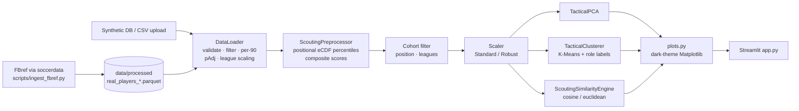

# ScoutIntel — Player Recruitment & Tactical Clustering Platform

An end-to-end analytics platform for football recruitment departments. It
normalises player season data for context (minutes, possession, league
strength), groups players into data-driven tactical roles, and finds
statistically similar replacements within a budget, age and contract brief —
all through an interactive Streamlit dashboard.

> [!IMPORTANT]
> **The default database is synthetic.** Every player name and statistic in
> the *Synthetic Enterprise DB* is generated by
> `src/data/synthetic_generator.py`; club and league names are real but used
> only as labels. For real players, ingest FBref's 2023-24 Top 5 data (see
> [Real data](#real-data-fbref-2023-24)) or upload your own CSV.

---

## Contents

- [What it solves](#what-it-solves)
- [Architecture](#architecture)
- [Data pipeline](#data-pipeline)
- [Machine learning & analytics engine](#machine-learning--analytics-engine)
- [Dashboard](#dashboard)
- [Quickstart](#quickstart)
- [Testing & quality assurance](#testing--quality-assurance)
- [Real data (FBref 2023-24)](#real-data-fbref-2023-24)
- [Project layout](#project-layout)

---

## What it solves

Recruitment teams face three recurring problems that raw stat tables do not
answer:

| Problem | How ScoutIntel addresses it |
|---|---|
| **Context distorts the numbers.** A centre-back at a 65%-possession side makes fewer tackles because his team rarely defends; a striker in a weaker league scores more against weaker defences. | Per-90 normalisation, a sigmoid **possession adjustment** for defensive actions and a **league strength coefficient** for volume output. |
| **Positions are not tactical roles.** "Midfielder" covers a deep-lying playmaker and a box-to-box runner. | **K-Means clustering** on the scaled 9-metric profile discovers roles from the data and **names them automatically** from each cluster's centroid. |
| **"Find me the next X, but cheaper and younger."** | A **weighted similarity engine** (cosine *and* Euclidean) ranks replacements inside hard **Moneyball constraints**: max age, budget cap and contract expiry. |

---

## Architecture



The codebase separates concerns strictly:

- **`src/data`, `src/features`, `src/models`** — pure, stateless analytics with
  full type hints; no Streamlit imports.
- **`src/pipeline.py`** — orchestration the dashboard calls (cohort fitting,
  shortlist, cluster summaries, export). Testable without a browser.
- **`src/visualization/plots.py`** — every chart takes an optional `ax` and
  returns a `Figure`.
- **`app.py`** — widgets, caching and layout only.
- **`src/config.py`** — the single source of truth for column names, feature
  categories, league coefficients and defaults.

---

## Data pipeline

### 1. Validation & filtering

`DataLoader` accepts the synthetic DB, a CSV path or an uploaded file buffer
(UTF-8 with a Latin-1 fallback for Excel exports). It checks that all required
columns exist, coerces numerics, and drops unusable rows (non-numeric minutes,
possession outside 0–100, negative counts). Players below `min_minutes`
(default **900**) are removed to avoid small-sample noise, and FBref position
strings such as `FW,MF` or `DF/MF` map to a primary group (`DF`, `MF`, `FW`)
using the first listed position. A `LoadReport` records how many rows each
stage dropped.

### 2. Per-90 normalisation

Every counting stat is converted to a per-90 rate, with a zero-minutes guard:

$$
\text{Stat}_{p90} = \frac{\text{Stat}}{\text{Minutes Played}} \times 90
$$

### 3. The 9 core metrics in 4 tactical categories

| Category | Metric | Measures |
|---|---|---|
| **Scoring** | `Goals_p90` | Clinical finishing |
| | `Shots_p90` | Shot volume / box presence |
| **Creation & Passing** | `Assists_p90` | Direct final-ball output |
| | `Key_Passes_p90` | Chance creation volume |
| | `Pass_Completion_Pct` | Ball retention security |
| | `Progressive_Passes_p90` | Line-breaking distribution |
| **Dribbling** | `Successful_Take_Ons_p90` | 1v1 ball carrying |
| **Defending** | `pAdj_Tackles_Won_p90` | Ball-winning aggression |
| | `pAdj_Interceptions_p90` | Reading of play |

The categories drive both the composite sub-scores and the similarity weight
sliders.

### 4. Sigmoid possession adjustment (pAdj)

Teams that dominate the ball give their defenders fewer chances to defend, so
raw tackle and interception counts understate them. Defensive per-90 stats are
rescaled with a sigmoid centred on 50% possession:

$$
\text{pAdj\_Stat} = \text{Stat}_{p90} \times \frac{2}{1 + e^{-k\,(\text{Possession}\% - 50)}}
$$

The multiplier is exactly **1.0** at 50%, rises towards 2.0 for dominant sides
and falls towards 0.0 for low-possession sides. It is symmetric:
$m(50+x) + m(50-x) = 2$.

**Why `k = 0.05` rather than 0.1.** The steepness `k` controls how hard the
correction bites:

| Team possession | 40% | 50% | 60% | 65% |
|---|---|---|---|---|
| Multiplier, `k = 0.10` | 0.54× | 1.00× | 1.46× | 1.64× |
| Multiplier, **`k = 0.05`** | **0.76×** | **1.00×** | **1.25×** | **1.36×** |

With `k = 0.10`, the correction **over-shot and inverted the bias**. On the
synthetic database, defenders at high-possession sides (≥ 55%) averaged 1.30
raw tackles per 90 against 1.63 at low-possession sides (≤ 45%). After `k = 0.10`
that flipped to 1.82 vs 1.04, so the adjustment penalised low-possession
defenders more than possession had ever penalised the others. At `k = 0.05`
the figures become 1.57 vs 1.32, and a 60%-possession side gets roughly a
1.25× boost, in line with commonly used linear possession adjustments
(≈ 50 / (100 − possession)). `k` is configurable via
`LoaderConfig(padj_steepness=...)` and in the dashboard sidebar; `0` disables
the adjustment.

### 5. League strength coefficients

Output against weaker opposition is worth less. Every per-90 **volume** stat is
multiplied by a league coefficient (`src/config.py`):

| Leagues | Coefficient |
|---|---|
| Premier League, La Liga, Serie A, Bundesliga, Ligue 1 | 1.00 |
| Eredivisie, Primeira Liga, Championship | 0.85 |
| Any other league | 0.85 (default, reported in the load log) |

Efficiency percentages such as `Pass_Completion_Pct` are **never** league-scaled:
the rule applies only to columns with the `_p90` suffix, so rate stats are
excluded by construction. Scaling can be switched off in the sidebar.

### 6. Position-isolated percentiles (eCDF)

Raw rankings across all players are misleading: a centre-back's 1.5 tackles per
90 should be judged against defenders, not against forwards who barely tackle.
Each metric is therefore converted to an empirical-CDF percentile **within its
`Position_Group` cohort**, using the mid-rank definition:

$$
P(x) = 100 \times \frac{\#\{v < x\} + \tfrac{1}{2}\,\#\{v = x\}}{n}
$$

This matches `scipy.stats.percentileofscore(kind="mean")`. Ties share a
percentile, so the many defenders on zero goals sit mid-table instead of being
ranked arbitrarily. A test confirms the isolation directly: a defender whose
raw tackle count is *below every forward* still ranks above the 80th
percentile among defenders.

### 7. Composite sub-scores

Each category's score (`Score_Finishing`, `Score_Creation`, `Score_Dribbling`,
`Score_Defending`) is the unweighted mean of its member percentiles, on a
0–100 scale.

---

## Machine learning & analytics engine

### Scaling

Features are scaled before any distance-based model:

- **`StandardScaler`** — z-scores, $z = (x - \mu) / \sigma$.
- **`RobustScaler`** (dashboard default) — $(x - \text{median}) / \text{IQR}$.
  A handful of elite outliers (the generator deliberately seeds ~2% of forwards
  at Haaland-tier output) cannot stretch the axis for everyone else.

### Tactical PCA

`TacticalPCA` projects the 9 scaled metrics onto the two orthogonal axes that
carry the most variance, giving the 2-D tactical map. Variance retained on the
synthetic database (robust scaling):

| Cohort | PC1 | PC2 | Cumulative |
|---|---|---|---|
| Forwards | 39.6% | 21.9% | **61.5%** |
| Midfielders | 48.2% | 21.4% | **69.6%** |
| Defenders | 36.6% | 18.5% | **55.1%** |

The **factor loadings** (eigenvector weights, shown in Tab 4) explain what
each axis means. For forwards, PC1 loads positively on assists, key passes,
progressive passes and take-ons (around +0.4 to +0.5) while goals and shots sit
near zero. PC1 is a *creator ↔ finisher* axis, and PC2 loads almost entirely
on goals and shots (+0.67, +0.68), a pure *goal threat* axis. Across all
positions combined, PC1 instead separates attacking output from defensive
work; a test asserts this.

### K-Means role clustering

`TacticalClusterer` runs `KMeans(n_clusters=k, n_init=10, random_state=42)`.

**Choosing k.** `compute_diagnostics` sweeps $k \in [2, 10]$ and reports:

- **Inertia** (within-cluster sum of squares) for the elbow curve:
  $\sum_i \lVert x_i - \mu_{c(i)} \rVert^2$.
- **Silhouette score** — for each player,
  $s = \dfrac{b - a}{\max(a, b)}$, where $a$ is the mean distance to their own
  cluster and $b$ to the nearest other cluster. Values of k that the silhouette
  cannot handle ($k \ge n$) are skipped rather than crashing.

**Automatic role labelling.** Because clustering runs in scaled space, a
centroid coordinate reads as "how far above or below the cohort norm this group
sits." The two most positive coordinates define the role through a 24-entry
lookup table, for example:

| Dominant pair | Role |
|---|---|
| Goals + Shots | Direct Goal Threat / Poacher |
| Progressive Passes + Pass Completion | Deep-Lying Playmaker / Recycler |
| Tackles + Interceptions | Ball-Winning Destroyer |
| Take-Ons + Key Passes | Dynamic 1v1 Creator |

Unmapped pairs, or pairs whose deviation is too weak to be distinctive
(< 0.25), fall back to `"Balanced <Trait 1> & <Trait 2> Specialist"`. Duplicate
names are disambiguated with the third-strongest trait, so every label is
unique.

**Validation against ground truth.** The synthetic generator records each
player's hidden archetype, which lets us measure how well clustering recovers
real roles with **Normalised Mutual Information** (0 = unrelated, 1 =
identical). At k = 5 with robust scaling, NMI is 0.45 for forwards, 0.65 for
midfielders and 0.68 for defenders. Forwards score lowest because inside
forwards and dribbling wingers genuinely overlap. Random labels score below
0.05.

### Dual-metric similarity search

`ScoutingSimilarityEngine` ranks replacements for a target player.

**Category weights.** Sliders weight the four categories. Each weight $w$ is
applied as $X_{\text{weighted}} = X \times \sqrt{w}$, which makes the squared
Euclidean distance weight each feature by exactly $w$:
$\sum_j w_j (u_j - v_j)^2$.

**Cosine similarity: tactical clones.**

$$
\text{sim}_{\cos}(u, v) = \frac{u \cdot v}{\lVert u \rVert_2\,\lVert v \rVert_2},
\qquad
\text{Match \%} = \frac{\text{sim}_{\cos} + 1}{2} \times 100
$$

Cosine compares the **direction** of a profile and ignores its length. A player
producing 40% of the target's output with the *same balance* of actions
scores 100%. That makes it the tool for **stylistic twins**: younger or cheaper
players who play the same way and may grow into the volume.

**Euclidean distance: like-for-like output.**

$$
\text{Match \%} = \max\!\left(0,\; 100 \times \left(1 - \frac{d(u, v)}{d_{95}}\right)\right)
$$

where $d_{95}$ is the 95th percentile of all pairwise distances in the
comparison pool. A high percentile rather than the maximum stops one extreme
pair from compressing everyone else's scores. Euclidean rewards **matching
magnitude**: a "finished product" who already delivers the target's numbers.

**Reading both together.** For the synthetic database's most expensive
forward (€177M), the best under-23 candidate valued below €15M scores **86% on
cosine but 43% on Euclidean**. He is a clone in *style*, but nobody in that
budget matches the *volume*. That gap is the scouting insight: you are buying
potential, not a like-for-like replacement.

**Filters never change scores.** Scores are computed against the full positional
pool *before* the recruitment filters (max age, max market value, max contract
years remaining) are applied, so tightening the budget changes who is shown,
never anyone's score. The target is always excluded from their own list.

---

## Dashboard

```bash
streamlit run app.py
```

### Sidebar

| Section | Controls |
|---|---|
| **Data Source & Scope** | Synthetic DB (with seed), Real Data (FBref 2023-24 Top 5) or CSV upload; minimum minutes |
| **Contextual Adjustments** | pAdj steepness `k`; league coefficients on/off |
| **Cohort** | Position group (FW / MF / DF); league multi-select |
| **Recruitment Constraints** | Max age, max market value (€M budget cap), max contract years remaining. A slider left at its maximum means "no constraint." |
| **Model Hyperparameters** | k (2–10), Robust vs Standard scaler, Cosine vs Euclidean |
| **Feature Weight Multipliers** | Scoring, Creation & Passing, Dribbling & Ball Carrying, Defending (0.0–3.0) |

### Tabs

1. **Target Player & Tactical DNA.** Searchable player selector (namesakes are
   disambiguated by club). KPI cards for age, club and league, value and
   contract, and assigned role. Composite score bars with qualitative tiers,
   an overall percentile rating, and a percentile radar.
2. **Moneyball Replacement Engine.** The top 10 shortlist with match %, value
   saved (green) or premium (red), contract expiry and role. A head-to-head
   selector shows match score, value delta, age gap, role alignment and a
   gold-vs-blue overlay radar.
3. **Tactical Role Clusters.** The PCA map with cluster colours and marker
   shapes, covariance ellipses, centroids, the target (gold star) and the top 5
   candidates (blue rings) labelled in a collision-free side lane. Cluster
   summary cards, the Cluster DNA heatmap, and a cohort explorer for browsing
   any role.
4. **Model Diagnostics & Export.** Elbow and silhouette curves with the active
   and silhouette-optimal k, PCA factor loadings, ground-truth NMI and a
   cross-tab (synthetic data only), and a timestamped CSV export of the full
   cohort with clusters, roles, PCA coordinates, composites and match % to the
   current target.

**Performance.** Data loading, model fitting, k-diagnostics and rendered charts
are cached with `st.cache_data`, each keyed on exactly the inputs it depends
on. The similarity search (~10 ms) runs live. A fully cached rerun measured
about 180 ms in the headless test harness.

**Visual design.** All charts share a dark theme on `#0e1117`. The 10-slot
cluster palette was validated against that surface for lightness, chroma,
colour-vision-deficiency separation and contrast. Because a scatter plot puts
every colour pair side by side, clusters also carry distinct marker shapes, so
identity never relies on colour alone.

---

## Quickstart

Requires **Python 3.13**.

```bash
# 1. Create and activate a virtual environment
python -m venv .venv
source .venv/bin/activate        # Windows: .venv\Scripts\activate

# 2. Install pinned dependencies
pip install -r requirements.txt          # dashboard only
pip install -r requirements-dev.txt      # + ingestion (soccerdata) and pytest

# 3. Run the test suite
pytest

# 4. Launch the dashboard
streamlit run app.py

# 5. Optional: ingest real 2023-24 data (see "Real data" below)
python scripts/ingest_fbref.py
```

The dashboard opens at <http://localhost:8501>. Use `--server.port` to change
the port.

Pinned runtime dependencies (`requirements.txt`): `streamlit 1.66.0`,
`pandas 3.0.6`, `numpy 2.5.4`, `scipy 1.18.1`, `scikit-learn 1.9.1`,
`matplotlib 3.11.2`, `pyarrow 26.0.0`. Ingestion adds `soccerdata 1.9.1`
(`requirements-ingest.txt`).

---

## Testing & quality assurance

**285 tests**, all passing, and also passing under `pytest -W error` (every
warning treated as a failure). The full suite runs in about 25 seconds and
needs no network access: FBref is replaced by fixtures shaped exactly like
`soccerdata` output.

| Suite | Tests | Covers |
|---|---|---|
| `test_synthetic_generator.py` | 28 | Schema, internal consistency (goals ≤ shots, pass % matches counts), football realism, determinism per seed, config validation |
| `test_loader.py` | 40 | CSV, buffer and encoding ingestion; validation errors; minutes and position filtering; per-90 math; pAdj direction, symmetry and steepness; league scaling that leaves percentages untouched |
| `test_preprocessor.py` | 22 | Both scalers, outlier resistance, zero-variance and NaN handling, eCDF against `scipy`, positional isolation, composite bounds |
| `test_pca.py` | 13 | Output shape, variance bounds, orthonormal loadings, degenerate inputs |
| `test_clustering.py` | 29 | Label ranges, diagnostics edge cases ($k \ge n$, duplicate points), unique role labels, NMI > 0.40 vs ground truth |
| `test_similarity.py` | 32 | Target exclusion, clone = 100%, cosine vs Euclidean behaviour, weight math, strict filter pruning, filters never changing scores |
| `test_plots.py` | 45 | Headless (`Agg`) rendering of every chart, value clipping, axis dimensions, theme isolation, **memory safety** |
| `test_real_data_pipeline.py` | 38 | FBref header flattening onto the raw schema, transfer deduplication (season totals, primary club, minutes-weighted possession, namesakes kept apart), enrichment with no nulls and deterministic proxies, `load_real` through the full pipeline, real-over-benchmark precedence, the rate-limit fallback never writing to the real path, failure classification, headless-by-default fetching |
| `test_app_smoke.py` | 38 | Pipeline helpers, plus `app.py` run end-to-end with Streamlit's `AppTest`: every cohort, metric and scaler, impossible filters, all-zero weights, empty league selection, upload mode, and the Real Data source (missing file, benchmark warning, estimate notice) |

**Test styles used**

- **Unit tests** on small hand-built frames with known answers (per-90 math,
  multiplier values, eCDF results checked against `scipy`).
- **Invariant tests** on the full synthetic database: target never in their
  own shortlist, percentiles always within [0, 100], filters never alter scores.
- **Parametrized edge cases** across scalers, metrics, k values and malformed
  inputs.
- **Headless UI smoke tests** that drive the real dashboard through
  `streamlit.testing.v1.AppTest`, change widgets and assert there are no
  exceptions and that the right warnings appear.
- **Memory-leak assertions.** Charts are built with `matplotlib.figure.Figure`
  rather than `pyplot`, so they never enter pyplot's global registry. Tests
  assert `plt.get_fignums()` stays empty and use `weakref` to confirm figures
  are garbage-collected.

The suite does not yet include randomised property-based testing (e.g.
Hypothesis); invariants are checked on fixed seeded data.

---

## Real data (FBref 2023-24)

The platform can run on real Top 5 league data for the 2023-24 season,
ingested from [FBref](https://fbref.com) with
[`soccerdata`](https://github.com/probberechts/soccerdata).

### Running the ingestion

```bash
pip install -r requirements-ingest.txt
python scripts/ingest_fbref.py                  # headless browser
python scripts/ingest_fbref.py --interactive    # visible browser, for FBref's CAPTCHA
```

Then choose **Real Data (2023-24 Top 5 European Leagues)** in the dashboard
sidebar.

| Option | Effect |
|---|---|
| `--season 2023-2024` | Season to ingest (default). |
| `--leagues "ENG-Premier League" "ESP-La Liga"` | Subset of the Top 5 (default: all five). |
| `--interactive` | Opens a visible browser so you can solve FBref's CAPTCHA by hand. |
| `--no-fallback` | Exit with an error instead of writing the benchmark (see below). |
| `--out-dir PATH` | Output directory (default `data/processed/`). |

Exit codes: `0` real data written, `1` fallback benchmark written, `2` failed
with `--no-fallback`.

### What the pipeline does

1. **Fetch** five player stat tables per league (standard, shooting,
   passing, possession, defense) plus the team standard table for possession.
2. **Flatten** FBref's two-level headers (`("Playing Time", "Min")` becomes
   `"Playing Time_Min"`) and map them onto the platform's raw schema
   (`src/data/fbref_transform.py`). Matching ignores case and spacing, and a
   missing column raises a clear `FBrefSchemaError`.
3. **Deduplicate mid-season transfers.** FBref's season tables list a
   transferred player once per club, with no aggregate row and no dates, so:
   counting stats are **summed** into season totals; the player is assigned to
   the club where they played the **most minutes** (the tables cannot say which
   club was "latest"); `Team_Possession_Pct` is the **minutes-weighted** average
   of their clubs; and players are keyed by `(name, birth year)` so namesakes
   are never merged.
4. **Enrich** (`src/data/real_data_enricher.py`) with possession, market value
   and contract expiry (see below).
5. **Write** `data/processed/real_players_2023_2024.parquet` and a `.csv` twin.

`DataLoader().load_real("2023-2024")` then runs the file through **exactly the
same pipeline** as every other source: validation, minutes filter, per-90,
pAdj (k = 0.05) and league coefficients. Goalkeepers are dropped by the
position filter.

### Estimated fields: market value and contracts

FBref publishes neither market values nor contract dates, and `soccerdata`
1.9.x has no Transfermarkt reader. Both are therefore **estimated**, labelled
per row, and flagged in the dashboard with a banner:

- **`Market_Value_EUR_M`** (`Market_Value_Source = "proxy"`) is deterministic:

  $$
  \text{value} = 120 \times q^{2.2} \times \text{age curve} \times \text{league coef} \times \text{usage}
  $$

  where $q$ blends within-position percentiles of scoring output and passing
  output (forwards weighted 70/30 towards scoring, midfielders 40/60, defenders
  20/80), the age curve peaks at 25, and usage rises with minutes. If a
  Transfermarkt source becomes available, fetched values replace the proxy
  row by row (`Market_Value_Source = "transfermarkt"`).
- **`Contract_Expiry_Year`** (`Contract_Source = "proxy"`) is a stable
  pseudo-random year in 2026–2029, seeded by a hash of name and birth year,
  so re-runs never reshuffle it.

Budget and contract filters on real data are therefore **indicative only**.
Contract years remaining are counted from the dataset's own season end (2024
for 2023-24), not from the synthetic database's 2026.

### Caching

- **Downloads:** `soccerdata` caches every FBref page under
  `~/soccerdata/data/FBref`. Once one run succeeds, later runs (and re-parsing
  after code changes) work offline without touching FBref.
- **Dashboard:** the processed file is loaded once with `st.cache_data`. The
  cache key includes the file's path and modification time, so re-running the
  ingestion is picked up automatically.

### Rate limits, CAPTCHAs and the fallback

FBref rate-limits automated traffic (HTTP 429) and may serve a CAPTCHA to
automated browsers. The script never tries to bypass a CAPTCHA. Any fetch
failure is caught, classified (rate limit, CAPTCHA or network) and logged, and
the script then writes a **synthetic benchmark** with the identical schema to
`data/processed/benchmark_players_2023_2024.parquet`, so the pipeline never
blocks.

The benchmark is **never written to the `real_players_*` path**. Every row
carries `Data_Origin = "synthetic-benchmark"`, the script exits with code 1,
and the dashboard shows a warning banner whenever it is loaded. Synthetic
players cannot be mistaken for real ones. If FBref shows a CAPTCHA, run with
`--interactive` once and solve it in the browser window; the cache makes
every later run offline.

### Data storage and terms

`data/` is git-ignored except for `data/processed/.gitkeep`. Processed files
are local artefacts and FBref's terms of use do not permit redistributing its
data. Check them, and those of any valuation source, before commercial use.

### Uploading your own CSV

Alternatively, choose **Upload Custom CSV**. The upload screen shows the
expected schema and offers a downloadable template. Required columns:

```text
Player, Squad, League, Position, Age, Minutes_Played, Market_Value_EUR_M,
Contract_Expiry_Year, Team_Possession_Pct, Goals, Shots, Assists, Key_Passes,
Pass_Completion_Pct, Progressive_Passes, Successful_Take_Ons, Tackles_Won,
Interceptions
```

Counting stats are **season totals**; the pipeline converts them to per-90.

---

## Project layout

```text
playerscout/
├── app.py                         # Streamlit dashboard (UI only)
├── requirements.txt               # pinned runtime dependencies
├── requirements-ingest.txt        # + soccerdata (real-data ingestion)
├── requirements-dev.txt           # + ingestion + pytest
├── scripts/
│   └── ingest_fbref.py            # FBref 2023-24 ingestion CLI with fallback
├── data/processed/                # generated parquet/csv (git-ignored)
├── .streamlit/config.toml         # dark theme
├── src/
│   ├── config.py                  # schema, categories, coefficients, defaults
│   ├── exceptions.py              # InsufficientDataError, TargetPlayerNotFoundError
│   ├── pipeline.py                # orchestration used by app.py
│   ├── data/
│   │   ├── synthetic_generator.py # FBref-style synthetic season database
│   │   ├── fbref_transform.py     # FBref tables -> raw schema, transfer dedup
│   │   ├── real_data_enricher.py  # possession, value & contract proxies
│   │   └── loader.py              # validation, per-90, pAdj, league scaling, load_real
│   ├── features/
│   │   └── preprocessor.py        # scaling, eCDF percentiles, composites
│   ├── models/
│   │   ├── pca.py                 # TacticalPCA
│   │   ├── clustering.py          # TacticalClusterer + role labelling
│   │   └── similarity.py          # ScoutingSimilarityEngine
│   └── visualization/
│       └── plots.py               # dark-theme Matplotlib suite
└── tests/                         # 285 tests (see above)
```
